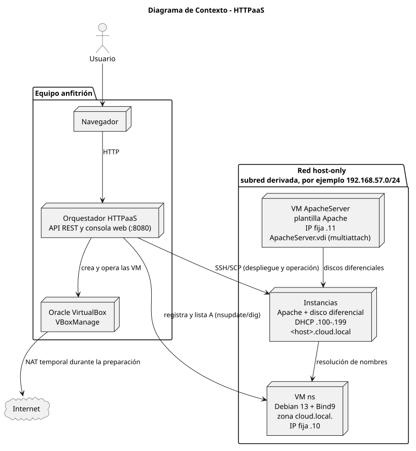

# HTTPaaS - Servicio Administrado de Páginas y Aplicaciones Web

Sistema de aprovisionamiento automatizado y no interactivo de instancias de servidor web Apache sobre máquinas virtuales Oracle VirtualBox con discos en modo multiconexión (`multiattach`) y registro dinámico en DNS Bind9 (`cloud.local.`), desarrollado en Go bajo Arquitectura Hexagonal.

Proyecto correspondiente a la **Nota Parcial #3 de Computación en la Nube (2026-2)**.

---

## 🧭 Diagrama de contexto



El orquestador expone la API y la consola en `:8080` y opera VirtualBox sobre la red host-only derivada. `ns` publica la zona `cloud.local.`, la plantilla `ApacheServer` conserva el disco `multiattach` y las instancias usan DHCP (`.100–.199`) sobre discos diferenciales.

## 📋 Requisitos

### Dependencias del sistema (instalación manual)

| Dependencia | Uso | Cómo obtenerla |
|---|---|---|
| **Go 1.22+** | Compilar y ejecutar el servidor | [go.dev/dl](https://go.dev/dl/) |
| **Task** | Automatizar formato, lint, pruebas y documentación | [taskfile.dev/installation](https://taskfile.dev/installation/) |
| **Git** | Clonar y versionar el proyecto | [git-scm.com/downloads](https://git-scm.com/downloads) |
| **Oracle VirtualBox 7** | Hipervisor y `VBoxManage` en el PATH | [virtualbox.org/wiki/Downloads](https://www.virtualbox.org/wiki/Downloads) |
| **OpenSSH** (`ssh`, `scp`, `ssh-keygen`) | Acceso y despliegue en las VM | Linux/macOS: preinstalado · Windows: [OpenSSH](https://learn.microsoft.com/windows-server/administration/openssh/openssh_install_firstuse) |
| **Herramientas ISO** | Crear las semillas NoCloud | Linux: `genisoimage` ([paquete](https://packages.debian.org/stable/genisoimage)) o `xorriso` ([xorriso](https://www.gnu.org/software/xorriso/)) · Windows: `oscdimg` si está disponible; si no, generador nativo incluido |

> Las VM **`ns`** y **`ApacheServer`** no se instalan a mano: las crea la preparación inicial. Lo mismo aplica a la imagen cloud, la red host-only y el disco `multiattach`.

## 🧭 Preparación inicial del laboratorio

La consola permanece **bloqueada** hasta que el laboratorio esté preparado: una pantalla guía el proceso (bienvenida → credenciales → confirmación → ejecución) y la API rechaza escrituras (`409`) mientras falte.

1. Pide el **usuario y la contraseña** del invitado; se usan en las semillas cloud-init.
2. Descarga la imagen cloud oficial de Debian 13 (`debian-13-generic-amd64.raw`, ~3 GB) si no existe en el directorio de datos.
3. Convierte la imagen a un VDI base una sola vez y duplica ese VDI para cada VM.
4. Genera una ISO semilla por VM (`genisoimage`, volumen `cidata`) desde `scripts/seeds/`; las VM base llevan una NIC NAT para descargar paquetes.
5. Arranca **`ns`** y la plantilla **`ApacheServer`**; cloud-init crea el usuario con la clave SSH e instala los paquetes; el orquestador sigue el avance por SSH.
6. Ejecuta `scripts/guest-bind9.sh` y `scripts/guest-apache.sh` para la zona DNS y el vhost.
7. Marca el disco de la plantilla en `multiattach` y guarda su ruta para los diferenciales.

### Directorio de datos

| Orden | Ruta | Uso |
|---|---|---|
| 1 | `HTTPAAS_DIR` | anula cualquier otra resolución |
| 2 | `/var/lib/httpaas` | si existe y es escribible |
| 3 | `$XDG_DATA_HOME/httpaas` o `~/.local/share/httpaas` | ejecución sin privilegios |

Contenido: `raw/` (imagen descargada), `seeds/` (user-data, meta-data e ISOs), `ssh/` (clave del laboratorio), `instances.json` y `setup-estado.json`. La aplicación no lee ni escribe fuera de este directorio.

El progreso se muestra paso a paso con un registro en vivo y se puede reabrir desde **Configuración** en el pie. Contrato completo en [`docs/setup-inicial.md`](docs/setup-inicial.md).

Flags relevantes: `-app-dir`, `-raw-url`, `-guest-user`, `-guest-pass`, `-install-timeout`, `-setup-state`.

## 🧪 Proyectos web de ejemplo

Dos sitios listos para probar el flujo completo desde la consola (selecciona el `.zip` al crear la instancia):

| Proyecto | Archivo | Qué incluye |
|---|---|---|
| **Paisajes** | [`example/paisajes.zip`](example/paisajes.zip) | Landing de turismo: portada ilustrada, destinos, cifras y experiencias. |
| **Financiero** | [`example/financiero.zip`](example/financiero.zip) | Landing fintech: panel con balance y gráfico, ventajas y seguridad. |

Ambos son autocontenidos (`index.html` + `styles.css`, sin recursos externos) y pesan menos de 5 KB. También están sin comprimir en `example/paisajes/` y `example/financiero/` por si quieres editarlos y volver a empaquetarlos; sirven igual para probar la actualización de despliegue con un nuevo `.zip`.

## 🛠️ Comandos de Desarrollo (Taskfile)

```bash
# Verificar herramientas del sistema
task doctor

# Ejecutar el servidor orquestador
task run

# Ejecutar suite de pruebas unitarias
task test

# Formatear código Go
task fmt

# Análisis estático (linter)
task lint

# Validación integral antes de commit
task check

# Regenerar documentación Markdown de paquetes Go
task doc

# Compilar el informe LaTeX (docs/informe/main.pdf)
task informe

# Compilar binario de producción
task build
```

## 📁 Estructura del Proyecto

Organizado bajo **Arquitectura Hexagonal (Puertos y Adaptadores)**:

- `cmd/server/`: Punto de entrada (`main.go`) y composición de dependencias.
- `internal/core/domain/`: Entidades de negocio (`Instance`, `DnsRecord`, etc.) e invariantes.
- `internal/core/ports/`: Interfaces de puertos desacoplados (`Hypervisor`, `DnsProvider`, `Deployer`, `Repository`, `Executor`, `EventLogger`).
- `internal/adapters/`: Implementaciones concretas (`vbox`, `bind9`, `deployer`, `filestore`, `localproc`).
- `internal/logging/`: Modelo de eventos y broker en memoria (anillo + suscripción SSE) que implementa `ports.EventLogger`.
- `internal/services/`: Casos de uso de la aplicación (`Orchestrator`, `InstanceService`).
- `internal/handlers/`: Controladores HTTP REST (instancias, DNS, salud, logs) y middleware.
- `web/`: Frontend modular (páginas, componentes compartidos, router y dock de logs).
- `docs/`: Documentación técnica (incluye [`instancias.md`](docs/instancias.md)), diagramas PlantUML y reporte en LaTeX.
- `.agents/skills/`: Reglas y contexto técnico para agentes inteligentes.

## 📄 Licencia

Este proyecto está bajo la Licencia Apache 2.0. Consulta el archivo [LICENSE](LICENSE) para más detalles.

